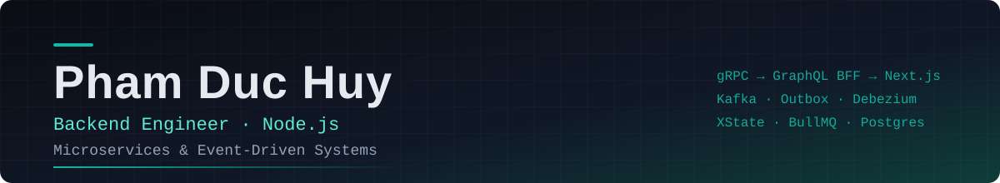

---

## About

Backend engineer with **5+ years** building distributed systems in logistics and gamification.
I care about **event-driven design, reliable messaging and high availability**: Kafka, transactional outbox, state-machine validation, and queue performance tuning.
I also lead production rollouts and mentor junior developers.

📍 Ho Chi Minh City, Vietnam &nbsp;·&nbsp; 🎓 VNUHCM – University of Science (Information Systems, 2018–2022)

## Now

Mid-Level Backend Developer at **Cyberlogitec**, seconded to **Chorus Virtual Company** (a joint venture of MTI, CLT and OTSV).
Working on a container logistics platform: **35+ microservices, 35+ teams**. I own its event processing end to end: gRPC backend → GraphQL BFF → Next.js UI.

👉 **[See the architecture, interactive](https://pdh372.github.io/my-cv/architecture/)** — a generic, public-safe walkthrough of the event pipeline.

## Tech stack

| | |
| --- | --- |
| **Core backend** | Node.js (Nest.js, Express) · TypeScript · REST · GraphQL · gRPC · XState v5 · TypeORM |
| **Messaging & queues** | Kafka (Avro, Schema Registry) · Transactional Outbox · Debezium (CDC) · BullMQ |
| **Database** | PostgreSQL (query tuning, indexing) · Redis · Valkey · MongoDB · Cloud SQL · AlloyDB |
| **Infrastructure** | Docker · Kubernetes (GKE) · GCP · Cloud Run · GitHub Actions · LaunchDarkly · Orkes Conductor · Nginx |
| **Architecture** | Clean Architecture · DDD · CQRS · Microservices · Event-Driven Design · Distributed Systems |
| **Frontend** | Next.js · React · Apollo Client · AG Grid |

## Selected work

- **Reliable events** — in-order Kafka publishing via a Debezium CDC transactional outbox; atomic bulk imports so partial saves never reach downstream systems.
- **Scaling queues** — BullMQ across multiple pods while keeping per-entity ordering with Postgres advisory locks.
- **Zero-downtime deploys** — graceful shutdown of queue workers and gRPC servers on GKE.
- **Validation pipelines** — XState v5 state machines validating 10+ logistics event types, one backend source of truth instead of scattered BFF checks.
- **Performance** — ~80% lower bulk event-creation latency by collapsing repeated external lookups into parallel, Valkey-cached calls.

## Experience

| Period | Role | Company |
| --- | --- | --- |
| 12/2023 – now | Mid-Level Backend Developer | **Cyberlogitec** (seconded to Chorus Virtual Company) |
| 03/2022 – 11/2023 | Junior Backend Developer | **Sqkii**: gamified marketing, 30,000+ active users, 1M+ records |
| 09/2021 – 02/2022 | Intern Frontend Developer | **HMSP**: internal admin dashboard (Next.js, React Query) |

## Recognition

🥈 2nd place — Cyberlogitec Hackathon Season 3 (2024)
🥉 3rd place — Chorus Virtual Company Hackathon Season 1 (2026)

## Languages

Vietnamese (native) · English (working proficiency)

---

**Hiring for a Senior backend role?** → [pdh372@gmail.com](mailto:pdh372@gmail.com) · [Full CV](https://pdh372.github.io/my-cv/)

